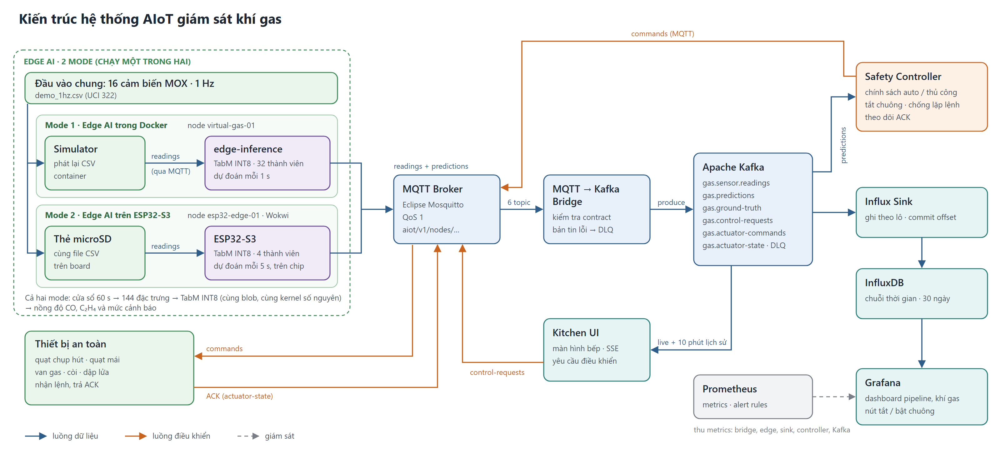

# AIoT Gas Safety · Bếp công nghiệp

Hệ thống giám sát khí gas cho bếp công nghiệp: 16 cảm biến MOX gửi dữ liệu qua MQTT, mô hình
TabM INT8 dự đoán nồng độ CO và C₂H₄ tại biên (gateway Docker hoặc ESP32-S3), Safety Controller
điều khiển quạt, van gas, còi. Dữ liệu được lưu qua Kafka vào InfluxDB và hiển thị trên Grafana
và màn hình bếp. Dữ liệu demo là `demo_data/demo_1hz.csv` (20% cuối bộ UCI 322, 1 Hz).

## Sơ đồ kiến trúc



## Quickstart

**Yêu cầu:** Docker Desktop 4.27+ (Engine 25+), PowerShell. Chạy trên ESP32 cần thêm VS Code với
PlatformIO và Wokwi Simulator.

1. Tải mã nguồn:
   ```powershell
   git clone https://github.com/LeHongCat/AIoT-ck-gas-sensor.git
   cd AIoT-ck-gas-sensor
   copy .env.example .env
   ```
2. Khởi động hệ thống (mô hình chạy trong Docker):
   ```powershell
   ./scripts/demo.ps1 up
   # hoặc: docker compose --profile demo up -d --build --wait
   ```
3. Mở giao diện:
   - Màn hình bếp: http://localhost:8080
   - Grafana: http://localhost:3000 (admin / `change-me-now`)
   - Prometheus alerts: http://localhost:9090/alerts
4. (Tuỳ chọn) Chạy mô hình trên ESP32-S3 (Wokwi):
   - Mở `wokwi/esp32-replay/esp32-replay` trong VS Code, chọn *PlatformIO: Build*.
   - Chạy `./scripts/demo.ps1 esp32`.
   - Mở `diagram.json`, chọn *Wokwi: Start Simulator*.
5. Kiểm thử và dừng:
   ```powershell
   ./scripts/demo.ps1 check   # pytest, ruff, kiểm tra compose
   ./scripts/demo.ps1 down    # dừng, giữ dữ liệu
   ```

## Kết quả benchmark

Đo ngày 24/10/2026 trên Docker Desktop (20 CPU, 15,3 GB RAM). Gateway giới hạn 0,5 CPU, chạy TabM
INT8 32 thành viên mỗi giây. Mỗi mức tải chạy 3 lượt, bảng ghi trung vị. Chi tiết:
[docs/benchmark-system.md](docs/benchmark-system.md), [docs/benchmark-model.md](docs/benchmark-model.md).

**Thử tải theo số nút** (mỗi nút là một thiết bị ảo gửi 1 mẫu/giây):

| Số nút | Gateway p50 / p95 | Kafka p95 | InfluxDB p95 | Dự đoán được lưu |
|---:|---:|---:|---:|---:|
| 1 | 14 / 18 ms | 29 ms | 0,48 s | 100% |
| 20 | 309 / 581 ms | 68 ms | 0,72 s | 100% |
| 40 | 558 / 1 369 ms | 103 ms | 0,73 s | 100% |
| 100 | 22,0 / 23,5 s | 462 ms | 1,12 s | 41,1% |

**Hệ thống và thiết bị biên:**

| Chỉ số | Kết quả |
|---|---|
| Dự đoán → thiết bị nhận lệnh (p95) | 45 ms |
| MQTT → màn hình bếp (p50 / p95) | 127 / 220 ms |
| Dừng Kafka 30 s / Influx Sink 60 s | không mất bản ghi |
| Dừng Bridge / Mosquitto 20 s | mất 24 s / 27 s dữ liệu |
| ESP32-S3 (Wokwi), suy luận p50 / p95, 4 thành viên | 4,49 / 6,78 s |
| ESP32-S3 (Wokwi), suy luận p50 / p95, 32 thành viên | 37,7 / 40,0 s |
| Firmware: Flash / RAM tĩnh | 77,4% / 43,2% |

**Mô hình TabM INT8:**

| Tập đánh giá | F1 CO | F1 C₂H₄ | F1 macro | RMSE CO | RMSE C₂H₄ |
|---|---:|---:|---:|---:|---:|
| Tập test | 0,880 | 0,837 | 0,810 | 95,1 ppm | 3,61 ppm |
| 20% cuối (dữ liệu demo) | 0,894 | 0,865 | 0,789 | 84,7 ppm | 3,55 ppm |

Số đo ESP32 là thời gian mô phỏng trên Wokwi, chưa phải phần cứng thật.

## Tuyên bố sử dụng AI (AI Disclosure)

- **Claude Code:** hỗ trợ viết và sửa code (pipeline, firmware, giao diện, dashboard), viết script
  benchmark và tài liệu kỹ thuật.
- **ChatGPT:** hỏi đáp kiến thức và biên tập văn bản báo cáo.

Số liệu benchmark và kết quả mô hình đều lấy từ các lần chạy thật; dữ liệu thô nằm trong
`docs/bench/`. Nhóm đã kiểm tra lại và chịu trách nhiệm về toàn bộ nội dung.
