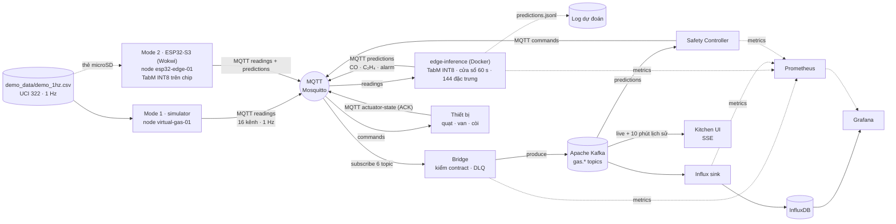

# AIoT Gas Safety · Bếp công nghiệp

Giám sát khí gas trong bếp công nghiệp bằng 16 cảm biến MOX, dự đoán CO/C₂H₄ bằng **TabM INT8 ở
edge**, và tự động điều khiển quạt, xả khí, van gas, còi. Mọi dữ liệu đi qua
**MQTT → Kafka → InfluxDB/Grafana** và hiển thị trên một màn hình bếp có người làm việc.
Input của demo là **`demo_data/demo_1hz.csv`** (bản ghi thật UCI 322, 1 dòng/giây, 2,3 giờ).

- [Sơ đồ kiến trúc](#sơ-đồ-kiến-trúc) · [Cấu trúc repo](#cấu-trúc-repo) ·
  [Quickstart](#quickstart) · [Kết quả benchmark](#kết-quả-benchmark) ·
  [Tuyên bố sử dụng AI](#tuyên-bố-sử-dụng-ai-ai-disclosure)

## Sơ đồ kiến trúc

<!-- Chèn ảnh sơ đồ kiến trúc tại đây, ví dụ:

-->

> _(Chỗ dành cho sơ đồ kiến trúc.)_

Luồng dữ liệu (GitHub hiển thị sơ đồ Mermaid dưới đây):



Hai mode dùng **cùng model** (cùng blob `tabm_int8.bin`, cùng kernel số nguyên) và **cùng file CSV**;
chỉ khác nơi chạy model:

| | Mode 1 · Edge AI trong Docker | Mode 2 · Edge AI trên ESP32-S3 |
|---|---|---|
| Ai phát 16 kênh | `simulator` (container) | board ESP32-S3 trong Wokwi, đọc CSV từ microSD |
| Ai chạy TabM | `edge-inference` (container): 32/32 thành viên, mỗi giây, ~10 ms | chính board: 4/32 thành viên, mỗi 5 s, ~4,5 s trong Wokwi |
| `node_id` | `virtual-gas-01` | `esp32-edge-01` |
| `model_version` | `seed42` | `seed42-k4` |
| Lệnh | `./scripts/demo.ps1 up` | `./scripts/demo.ps1 esp32` + bấm chạy Wokwi |

## Cấu trúc repo

| Thành phần | Thư mục / tệp |
|---|---|
| Thu thập dữ liệu / giả lập | `src/aiot_pipeline/simulator.py` (phát lại CSV qua MQTT), `wokwi/esp32-replay/` (firmware ESP32-S3: đọc microSD, suy luận TabM INT8 trên chip, nhận lệnh, trả ACK), `demo_data/demo_1hz.csv` |
| Data pipeline | `src/aiot_pipeline/`: `mqtt_kafka_bridge.py`, `edge_inference.py`, `influx_sink.py`, `safety_controller.py`, `contracts.py` (lược đồ sự kiện), `topics.py` |
| Docker / hạ tầng | `compose.yaml`, `Dockerfile`, `infra/` (Mosquitto, Prometheus + alert rules, Grafana provisioning + dashboard), `scripts/demo.ps1` |
| Mô hình & tối ưu | `model/` (TabM INT8 QDQ ONNX, tiền xử lý, ngưỡng), `src/aiot_pipeline/tabm_model.py` (suy luận số nguyên trên gateway), `tools/export_tabm_esp32.py` (xuất blob INT8 cho gateway + firmware), `tools/tabm_reference.py` (đối chiếu onnxruntime), `tools/train_edge_model.py` (huấn luyện model Ridge dự phòng) |
| Giao diện người dùng | `src/aiot_pipeline/demo_ui.py` + `src/aiot_pipeline/static/` (màn hình bếp), `infra/grafana/build_dashboards.py` (sinh dashboard Grafana) |
| Kiểm thử & benchmark | `tests/` (pytest + smoke test UI), `scripts/bench/` (thử tải, điều khiển, phục hồi, UI, Wokwi, chất lượng model), `docs/bench/system-2026-10-24/` (kết quả thô) |
| Tài liệu | `docs/architecture.md`, `docs/benchmark-system.md`, `docs/benchmark-model.md` |

Notebook huấn luyện và lượng tử hóa mô hình: _(bổ sung đường dẫn)_.

## Quickstart

### Bước 0 · Yêu cầu

- **Docker Desktop 4.27+** (Docker Engine 25+, Compose v2), cần cho healthcheck `start_interval`.
  Lần đầu chạy sẽ pull image (~2 GB) và build image Python (~1 phút).
- PowerShell (Windows PowerShell 5.1 hoặc PowerShell 7). Không có PowerShell thì dùng các lệnh
  `docker compose` ghi bên dưới mỗi bước.
- Chỉ cho **mode 2**: VS Code + extension **PlatformIO IDE** + **Wokwi Simulator** (cần license
  miễn phí: `F1` → *Wokwi: Request a New License*).

### Bước 1 · Lấy mã nguồn

```powershell
git clone https://github.com/LeHongCat/AIoT-ck-gas-sensor.git
cd AIoT-ck-gas-sensor
copy .env.example .env      # tuỳ chọn: đổi mật khẩu Grafana / InfluxDB
```

### Bước 2 · Chạy mode 1 (Edge AI trong Docker)

```powershell
./scripts/demo.ps1 up
# không có PowerShell:  docker compose --profile demo up -d --build --wait
```

Lệnh chỉ trả về khi **mọi** container đã healthy, rồi kiểm tra dự đoán đầu tiên đã tới UI và in
đường dẫn:

```text
Mọi service đã healthy sau 35 s.
Dự đoán đầu tiên của virtual-gas-01: NORMAL · CO 0.0 ppm (tabm-int8/seed42) sau 1.2 s
Bếp công nghiệp (UI)   http://localhost:8080
...
```

Simulator chỉ bắt đầu phát khi bridge, edge model và Safety Controller đã sẵn sàng, nên **gói đầu
tiên (seq 0) đã có dự đoán, lệnh và ACK**.

### Bước 3 · Mở giao diện

| Mở | Để làm gì |
|---|---|
| [http://localhost:8080](http://localhost:8080) | **Bếp công nghiệp**: trạng thái khí, mặt bằng, e-nose, thiết bị (ACK), pipeline, MQTT, log |
| [http://localhost:3000](http://localhost:3000) | **Grafana** (admin / mật khẩu trong `.env`, mặc định `change-me-now`), mở thẳng vào bản đồ pipeline |
| [http://localhost:9090/alerts](http://localhost:9090/alerts) | Cảnh báo Prometheus |

### Bước 4 · (Tuỳ chọn) Chạy mode 2 (Edge AI trên ESP32-S3, Wokwi)

1. **Build firmware** (một lần, và sau mỗi lần sửa `src/`): mở thư mục
   `wokwi/esp32-replay/esp32-replay` trong VS Code → *PlatformIO: Build* (env `esp32s3`). Lần đầu
   PlatformIO tải toolchain ESP32 (vài phút). Kết quả: `.pio/build/esp32s3/firmware_merged.bin`
   (file mà `wokwi.toml` nạp; `.pio/` không nằm trong git).
2. **Khởi động pipeline ở mode ESP32**:

   ```powershell
   ./scripts/demo.ps1 esp32
   # không có PowerShell:
   #   docker compose rm -sf simulator
   #   DEMO_NODE_ID=esp32-edge-01 docker compose --profile esp32 up -d --build --wait
   ```

   Simulator bị gỡ (board phát chính file CSV đó), màn hình được ghim vào `esp32-edge-01`.
   `edge-inference` vẫn chạy nhưng không dự đoán thay board (`EDGE_SKIP_NODES=esp32-edge-01`).
3. **Chạy board**: trong VS Code mở `diagram.json` → `F1` → *Wokwi: Start Simulator*. Wokwi for
   VS Code dùng Private IoT Gateway tích hợp, nên `host.wokwi.internal:1883` trỏ tới Mosquitto
   trên máy bạn. Serial monitor in:

   ```text
   Model tabm-int8/seed42-k4 ready (3986240 bytes of INT8 weights in flash, 4/32 members, every 5 s)
   Dataset opened: /demo_1hz.csv (...)
   MQTT broker host.wokwi.internal is ...
   MQTT connected; subscribed to commands
   TabM seq=0 P(CO)=0.1.. CO=0.0 ppm ... alarm=normal 4480 ms
   ```

   Board chờ SNTP đặt đồng hồ rồi mới phát (tránh timestamp 1970), và dự đoán **ngay gói đầu tiên**
   (cửa sổ chưa đủ 60 s được đệm bằng mẫu cũ nhất, giống gateway). LED đỏ GPIO 2 sáng khi Safety
   Controller bật còi.
4. Quay lại mode 1: `./scripts/demo.ps1 up`.

### Bước 5 · Kiểm thử và dừng

```powershell
./scripts/demo.ps1 check     # pytest + ruff + dashboard đồng bộ + compose config
./scripts/demo.ps1 down      # dừng, giữ dữ liệu
```

Các lệnh khác: `./scripts/demo.ps1 ui` (build lại UI) · `status` (health + CPU/RAM) · `logs` ·
`dashboards` (sinh lại Grafana). Không dùng `docker compose down -v` trừ khi muốn xóa toàn bộ dữ
liệu Kafka, InfluxDB, Mosquitto, Grafana và Prometheus.

## Kết quả benchmark

Phiên đo 24/10/2026, Docker Desktop (WSL2), 20 CPU logic, 15,3 GB RAM. Gateway chạy TabM INT8
32 thành viên ở 1 Hz, giới hạn 0,5 CPU. Mỗi nút là một thiết bị ảo phát lại `demo_1hz.csv` ở 1 Hz
và trả ACK. Mỗi mức tải: 30 s làm nóng + 120 s đo, 3 lượt, bảng ghi trung vị. Chi tiết, cách đo
và cách chạy lại: [docs/benchmark-system.md](docs/benchmark-system.md),
[docs/benchmark-model.md](docs/benchmark-model.md); số liệu thô ở
[docs/bench/system-2026-10-24/](docs/bench/system-2026-10-24/).

**Thông lượng và độ trễ theo số nút** (các nút phát đồng loạt mỗi giây):

| Nút | Dự đoán/s | Gateway p50 / p95 | Kafka p95 | InfluxDB p95 | Lưu dự đoán | CPU gateway |
|---:|---:|---:|---:|---:|---:|---:|
| 1 | 1,0 | 14 / 18 ms | 29 ms | 0,48 s | 100 % | 0,04 lõi |
| 10 | 10,0 | 91 / 300 ms | 33 ms | 0,74 s | 100 % | 0,14 lõi |
| 20 | 20,0 | 309 / 581 ms | 68 ms | 0,72 s | 100 % | 0,23 lõi |
| 40 | 40,0 | 558 / 1 369 ms | 103 ms | 0,73 s | 100 % | 0,44 lõi |
| 60 | 46,7 | 20,4 / 23,0 s | 232 ms | 0,75 s | 78,1 % | 0,50 lõi |
| 100 | 46,1 | 22,0 / 23,5 s | 462 ms | 1,12 s | 41,1 % | 0,50 lõi |

Mẫu cảm biến được lưu 100 % ở mọi mức (không trùng, không sai thứ tự). Gateway bão hòa ở ~46 dự
đoán/s; với tiêu chí gateway p95 ≤ 1 s và lưu đủ, cấu hình mặc định đáp ứng **20 nút**. Chạy liên
tục 30 phút với 20 nút: p95 714 ms, lưu 100 %, 0 lỗi.

**Đầu-cuối, phục hồi và thiết bị biên:**

| Hạng mục | Kết quả |
|---|---|
| Dự đoán → thiết bị nhận lệnh / phát ACK | p95 45 ms / 46 ms |
| MQTT → Kitchen UI (client SSE / DOM cập nhật) | p50 127 ms, p95 220 ms / p50 261 ms, p95 1 231 ms |
| Khởi động nguội → dữ liệu đầu tiên | 35–37 s |
| Chính sách điều khiển C01–C11 | 9/11 đạt (C01a: đúng biên τ; C09: ACK sai `node_id` vẫn được nhận) |
| Dừng Influx Sink 60 s / Kafka 30 s | 0 bản ghi mất; ghi bù xong sau 46 s / 65 s |
| Dừng Bridge 20 s / Mosquitto 20 s | mất 24 s / 27 s dữ liệu |
| ESP32-S3 (Wokwi), suy luận p50 / p95, 4 thành viên | 4 489 / 6 779 ms, giữ được nhịp 5 s (0 cửa sổ bị bỏ) |
| ESP32-S3 (Wokwi), suy luận p50 / p95, 32 thành viên | 37 746 / 39 985 ms |
| Firmware: Flash / RAM tĩnh / heap trống thấp nhất | 77,4 % / 138 KiB (43,2 %) / 89 740 B |
| C++ firmware so với onnxruntime | 0/192 quyết định khác nhau |

**Chất lượng mô hình (TabM INT8):**

| Tập đánh giá | F1 CO | F1 C₂H₄ | F1 macro 4 lớp | RMSE CO | RMSE C₂H₄ |
|---|---:|---:|---:|---:|---:|
| Khối test (60–80 % bản ghi, theo notebook huấn luyện) | 0,880 | 0,837 | 0,810 | 95,1 ppm | 3,61 ppm |
| 20 % cuối (`demo_1hz.csv`, dữ liệu replay của demo) | 0,894 | 0,865 | 0,789 | 84,7 ppm | 3,55 ppm |

Trên 20 % cuối (2,3 giờ): phát hiện 17/17 đợt CO, trễ ~19–20 s, 0 báo động giả (cận trên 95 %
≈ 1,3 lần/giờ).

Giới hạn: số đo ESP32 là thời gian mô phỏng trong Wokwi, chưa phải chip thật; ACK là phản hồi
phần mềm, chưa xác nhận cơ cấu vật lý; dữ liệu là CO/C₂H₄ đo trong buồng thí nghiệm.

## Kịch bản demo (~6 phút)

Thời gian tính từ lúc lệnh `up` trả về (mode 1) hoặc lúc board kết nối MQTT (mode 2). Dữ liệu là
bản ghi thật nên mốc của hai mode gần như trùng nhau:

| Thời điểm | Trong file CSV | Màn hình |
|---|---|---|
| 0:00 | không khí có C₂H₄ ~8 ppm, CO 0 | `NORMAL`, tag `C₂H₄` (TabM báo C₂H₄ nhưng chỉ CO gây alarm), thiết bị tắt, van mở |
| ~1:55 | CO 240 ppm (từ giây 98) | `DANGER`: quạt chụp hút + quạt mái bật, **van gas khóa**, còi + đèn chớp, 9 nhân sự sơ tán ra điểm tập trung, toast + nhật ký an toàn |
| ~5:30 | CO về 0 (giây 304, cảm biến MOX hồi chậm) | `NORMAL`, thiết bị tắt, kết thúc sơ tán |
| ~8:30 → ~10:25 | CO 213 ppm | `DANGER` → `NORMAL` lần hai |
| ~12:05 → ~13:40 | CO 347 ppm | `DANGER` → `NORMAL` lần ba |

Gợi ý trình bày:

1. Mở `:8080`: badge **LIVE · SSE PUSH**, `NORMAL`, giá trị 16 kênh trên bo e-nose, thiết bị
   *"từ ACK"*. Cuộn xuống **Pipeline dữ liệu**: mỗi chấm là một gói tin thật; **MQTT Live
   Inspector** cho thấy payload JSON từng topic.
2. **Edge model**: 6 bước có số sống (cửa sổ 60 s → 144 đặc trưng → TabM INT8 → alarm → log),
   log cảm biến và log dự đoán từng giây.
3. Ở ~1:55 khí CO vào: theo dõi các vòng trên e-nose tăng (TGS2600/TGS2620), trạng thái chuyển
   `DANGER`, lệnh → ACK trong vài chục ms, mặt bằng sơ tán.
4. Mở Grafana ② ③ (thiết bị & cảm biến, MQTT) trong lúc `DANGER` để chỉ ra từng kênh và từng topic.
5. Chuyển sang mode 2 (`./scripts/demo.ps1 esp32` + Wokwi) để cho thấy cùng model chạy **trên
   chip**: cùng kịch bản, nhưng `seed42-k4` và ~4,5 s/lần suy luận.

> Cảm biến phát lại từ tệp ghi thật, nên hành động của thiết bị **không** làm đổi nồng độ khí;
> màn hình chỉ hiển thị trạng thái thiết bị đã được ACK.

### Màn hình bếp `:8080`

1. **Trạng thái khí** (trên cùng): NORMAL / WARNING / DANGER theo model đang dự đoán, các thiết
   bị đang chạy, CO và C₂H₄ **dự đoán** kèm giá trị **thực tế** và sai lệch, vạch thực tế trên
   thanh đo, xu hướng 3 phút với 4 đường (dự đoán liền, thực tế nét đứt).
2. **Mặt bằng bếp**: line nóng dưới chụp hút, pass, bàn nguội, sơ chế, kho lạnh, khu rửa, lối
   thoát hiểm. **9 nhân sự** làm việc theo vai trò. Mọi thứ phản ứng theo **trạng thái thiết bị đã
   ACK**: quạt quay, van gas khóa thì lửa tắt, còi bật thì đèn chớp, `danger` thì cả đội sơ tán.
   Bên phải là **e-nose**: bo 16 cảm biến MOX (4 loại × 4) với vòng đo mức tăng so với nền sạch.
3. **Hành động tự động**: trạng thái từng thiết bị (quạt chụp hút, quạt mái, van gas, còi, dập
   lửa) đúng như thiết bị đã xác nhận; lệnh gần nhất, thời điểm ACK, round-trip lệnh → ACK; **độ
   chính xác mô hình** 10 phút gần nhất (MAE CO, MAE C₂H₄, tỉ lệ phát hiện đúng, số cặp).
4. **Pipeline dữ liệu**: sơ đồ Cảm biến → Edge → **MQTT** → Bridge → **Kafka** →
   InfluxDB/Grafana, Safety Controller, UI; **MQTT Live Inspector** bên phải.
5. **Edge model**: 6 bước có số liệu sống, **log cảm biến** (16 kênh thô mỗi giây) và **log dự
   đoán** (CO/C₂H₄ dự đoán / thực tế, alarm, thời gian suy luận).
6. **Cảm biến**: 16 kênh nhóm theo loại khí với sparkline 3 phút và % tăng so với nền.
7. **Nhật ký an toàn** và **Luồng Kafka** (msg/s, độ trễ từng topic tới UI).

Màn hình theo **một node** tại một thời điểm (đổi khi node đang xem im lặng 5 s);
`DEMO_NODE_ID` ghim cố định một node.

### Grafana

**Pipeline Operations** (trang chủ):

- **① Pipeline**: bản đồ, mỗi ô một tầng với số liệu sống; viền/mũi tên đỏ khi tầng đó dừng.
- **② Thiết bị & cảm biến**: node nào đang gửi, gói/giây theo loại, bảng 16 kênh (giá trị +
  % tăng, sắp xếp kênh phản ứng mạnh nhất lên đầu), timeline "kênh nào đang phản ứng với khí".
- **③ MQTT**: client, subscription, retained, bảng `topic MQTT → topic Kafka` (msg/s, bytes/s,
  kích thước payload, lần nhận cuối), ai publish/subscribe, độ trễ chặng MQTT.
- ④–⑨: alert, throughput & ngân sách latency, control plane, bridge/DLQ, Kafka, InfluxDB.

**AIoT Gas Monitoring**: CO/C₂H₄ dự đoán real-time có dải ngưỡng, timeline alarm và thiết bị (cả
dập lửa, chuông tắt tay), panel **Chuông cảnh báo** (đèn, chuông, nút tắt/bật), audit trail lệnh,
**log dự đoán** và **log cảm biến** từng giây, 16 kênh MOX. Grafana chỉ hiển thị đầu ra của
pipeline, không có ground truth. Cả hai dashboard có biến `Node` và annotation cho các đoạn
**DANGER** / **Direct override**.

## Chính sách an toàn

| Alarm level | Quạt | Xả khí | Van gas | Còi | Dập lửa |
| ----------- | :---: | :------: | :-------------: | :--: | :-------: |
| `normal`  | tắt | tắt | mở | tắt | — |
| `warning` | bật | bật | mở | bật | — |
| `danger`  | bật | bật | **khóa** | bật | — |

- TabM (mặc định, cả hai mode): `warning` khi trung bình 5 s của P(CO) ≥ τ = 0,48; `danger`
  khi trung bình 5 s của CO ≥ 200 ppm. C₂H₄ được ước lượng và hiển thị nhưng không gây alarm.
- Ridge (`EDGE_MODEL=ridge`): `warning` khi CO (trung bình 5 s) ≥ 50 ppm, tắt khi < 40 ppm, hoặc
  C₂H₄ ≥ 3 ppm; `danger` khi CO ≥ 200 ppm.
- Operator can thiệp 30 s; `danger` luôn trả quyền cho Auto nhưng **chỉ thêm bảo vệ**: lần phun
  dập lửa đang chạy được giữ tới hết hạn. Dập lửa luôn kèm khóa gas + còi và không bao giờ tự bật.
- Lệnh operator đi UI → MQTT → Bridge → Kafka → Safety Controller (audit được); UI chỉ đổi khi
  thiết bị ACK. Controller chỉ phát lệnh khi trạng thái mong muốn đổi.

### Tắt / bật chuông cảnh báo

Công tắc **Chuông cảnh báo** có ở card Điều khiển của màn hình bếp và ở panel **Chuông cảnh báo**
của dashboard Gas Monitoring (cần quyền Editor). Biến *Node chuông* tự chọn node vừa gửi reading
gần nhất, tức node màn hình bếp đang theo dõi.

- Tắt chuông chỉ làm `alarm_on = false`. Chế độ vẫn **AUTO**: quạt, xả khí và van gas vẫn theo
  alarm; cảm biến, model, dự đoán và log (Kafka, InfluxDB, `predictions.jsonl`) chạy y như cũ.
- Mọi bước được ghi log như chế độ Auto: request `mode=mute|unmute` (`actuator_control_request`),
  lệnh và ACK mang thêm `alarm_muted` (`actuator_command`, `actuator_state`), Prometheus
  `aiot_siren_muted`. Grafana hiện "Chuông tắt tay" ở *Lịch sử actuator*, *Audit trail lệnh* và
  *Alarm & chế độ*.
- **DANGER mới tự bật lại chuông** (chuyển từ normal/warning sang danger); phun dập lửa luôn kèm
  còi. Safety Controller khởi động lại cũng bật lại chuông (trạng thái tắt chỉ giữ trong RAM).
- Alert `AiotSirenMuted` khi chuông bị tắt quá 10 phút.
- Nút trên Grafana gọi `POST {Kitchen UI}/api/control` ngay từ trình duyệt: Kitchen UI chỉ cho
  phép origin của Grafana (`GRAFANA_PUBLIC_URL`, mặc định `http://localhost:3000`).

> Demo local chưa phải hệ thống safety-certified: triển khai thật cần đăng nhập/RBAC, TLS + ACL
> cho MQTT/Kafka và interlock vật lý độc lập. Còi trên ESP32 hiện bật theo lệnh từ Safety
> Controller, nên vẫn phụ thuộc vào kết nối mạng.

## Vị trí cảm biến

16 cảm biến **không** rải khắp bếp mà nằm chung **một bo e-nose** trong chụp hút, cạnh ống gas:

- Model là "mũi điện tử": nó đọc cả 16 kênh **cùng một mẫu khí** (như buồng đo của UCI 322) và
  dựa vào tỉ lệ giữa các loại cảm biến để tách CO với C₂H₄. Rải 16 cảm biến cách nhau vài mét
  thì mỗi kênh thấy nồng độ và thời điểm khác nhau, đặc trưng mất ý nghĩa.
- Mọi nguồn gas (ống gas, 6 thiết bị nấu) đều nằm dưới chụp hút. CO và C₂H₄ nặng gần bằng không
  khí nên đi theo luồng hút về chỗ đặt bo: điểm xa nhất trên line cách bo ~4,7 m, điểm rò demo
  1,5 m. Riêng LPG nặng hơn không khí: bếp dùng LPG cần thêm đầu dò sát sàn cạnh tủ gas.
- Bếp lớn hơn hoặc có nhiều khu gas: thêm **node** e-nose (mỗi node 16 cảm biến + model riêng)
  cho từng khu. Pipeline đã tách theo `node_id` từ MQTT topic tới Kafka key, edge-inference và
  Safety Controller.

## Edge model & log

Hai luồng chạy song song mỗi giây:

| Luồng | Đi qua | Lưu ở đâu |
|---|---|---|
| **16 cảm biến → log** | simulator/board → MQTT `…/readings` → Bridge → Kafka `gas.sensor.readings.v1` → Influx sink | InfluxDB `sensor_reading` (16 field `s1…s16`) · Kafka 7 ngày |
| **16 cảm biến → model → dự đoán → log** | MQTT `…/readings` → **edge-inference** (hoặc board ESP32): cửa sổ 60 s → 144 đặc trưng (9 × 16: last, mean, std, min, max, slope, d5, d15, d30) → chuẩn hóa → **TabM INT8** → P(có khí), ppm, độ bất định → TB 5 s → alarm → MQTT `…/predictions` → Bridge → Kafka → Influx | InfluxDB `gas_prediction` (ppm, alarm, `inference_ms`, `window_s`) · `/logs/predictions.jsonl` (16 input + output + P + độ bất định, xoay vòng 5 MB × 3) |

Dự đoán giữ nguyên `observed_at` và `sequence` của gói cảm biến nên hai log ghép được theo `seq`.
`window_s` là số giây thật trong cửa sổ (1…60): dưới 60 nghĩa là node vừa khởi động và cửa sổ được
đệm bằng mẫu cũ nhất.

- **TabM INT8** (`model/TabM_seed42_int8_static.onnx` → `wokwi/.../model/tabm_int8.bin` +
  `tabm_int8.json`): ensemble 32 thành viên, 4 block × 1024, lượng tử INT8 QDQ. Gateway
  (`src/aiot_pipeline/tabm_model.py`) và firmware (`src/tabm_int8.cpp`) đọc **cùng một blob** và
  chạy cùng phép tính số nguyên; cả hai được so với onnxruntime trên `host_test/golden.bin`
  (`tests/test_tabm_gateway.py`, `host_test/host_test.cpp`).
- Biến môi trường của `edge-inference`: `EDGE_MODEL` (`tabm` | `ridge`), `TABM_MEMBERS` (32),
  `TABM_INFER_EVERY_S` (1), `EDGE_SKIP_NODES` (`esp32-edge-01`), `EDGE_ON_DEVICE_TIMEOUT_S` (30).
- **Ridge** (`EDGE_MODEL=ridge`, `src/aiot_pipeline/models/edge_ridge_v1.json`) là model dự phòng,
  Python thuần, huấn luyện trên dữ liệu **tổng hợp**; không dùng cho `demo_1hz.csv` (thang đo cảm
  biến thật khác hẳn).

```powershell
docker compose exec edge-inference tail -n 3 /logs/predictions.jsonl   # log dự đoán
python tools/tabm_reference.py                                           # TabM trên cả CSV (cần onnxruntime)
python tools/export_tabm_esp32.py                                        # xuất lại blob cho gateway + firmware
```

## Dữ liệu cảm biến

Input duy nhất là `demo_data/demo_1hz.csv` (`t_s, CO, Ethylene, S1..S16`, 8 419 dòng = 2,3 giờ,
20 % cuối của UCI 322 mà benchmark giữ lại để test). Mỗi giây nguồn phát lại (simulator hoặc
board ESP32) công bố hai bản tin cùng `observed_at` và `sequence`:

- `readings`: 16 cột cảm biến, **đầu vào duy nhất** của model;
- `ground-truth`: hai cột nhãn CO/C₂H₄ của bản ghi (`gas.ground-truth.v1`, InfluxDB
  `gas_ground_truth`). Nhãn chỉ để hiển thị và đánh giá: model không đọc, Safety Controller không
  dùng (có test khóa điều này).

Chỉ màn hình bếp đặt dự đoán cạnh giá trị thực tế, kèm MAE và tỉ lệ phát hiện đúng (CO ≥ 50 ppm,
C₂H₄ ≥ 1 ppm) trên các cặp cùng `sequence`; Grafana không hiển thị ground truth. Tắt bằng
`SIMULATOR_PUBLISH_GROUND_TRUTH=false`.

- Mode 1: `simulator` đọc file qua volume `./demo_data` (`DATASET_PATH`), phát 1 dòng/giây
  (`SIMULATOR_INTERVAL_SECONDS`), hết file thì phát lại từ đầu (`SIMULATOR_LOOP`).
- Mode 2: board đọc `/demo_1hz.csv` trên thẻ microSD ảo (thư mục `wokwi/.../sdcard/`, cùng nội dung).

Không có file CSV thì simulator dùng dữ liệu tổng hợp (chỉ hợp với `EDGE_MODEL=ridge`), kèm các
kịch bản rò rỉ qua topic `demo-scenario`/`demo-state`.

Dùng thiết bị thật: `docker compose rm -sf simulator`; thiết bị publish
`aiot/v1/nodes/{id}/readings`, subscribe `.../commands`, và publish ACK `.../actuator-state`.

## Topic map

| Dữ liệu | MQTT `aiot/v1/nodes/{id}/…` | Kafka | InfluxDB |
|---|---|---|---|
| Sensor | `readings` | `gas.sensor.readings.v1` | `sensor_reading` |
| Prediction | `predictions` | `gas.predictions.v1` | `gas_prediction` |
| Ground truth (nhãn CO/C₂H₄ của bản ghi) | `ground-truth` | `gas.ground-truth.v1` | `gas_ground_truth` |
| Operator override/cancel | `control-requests` | `gas.control-requests.v1` | `actuator_control_request` |
| Lệnh actuator | `commands` | `gas.actuator-commands.v1` | `actuator_command` |
| ACK thiết bị | `actuator-state` | `gas.actuator-state.v1` | `actuator_state` |
| Payload sai contract | — | `gas.dead-letter.v1` | — |
| Kịch bản rò rỉ (chỉ dữ liệu tổng hợp) | `demo-scenario` | — | — |
| Trạng thái rò rỉ (chỉ dữ liệu tổng hợp) | `demo-state` (retained) | — | — |

## Tài nguyên

Mỗi container có trần CPU/RAM, log xoay vòng 3 × 10 MB, dữ liệu có hạn mức. RAM đo bằng
`docker stats` trong phiên benchmark 24/10 (1 nút):

| Service | RAM đo được | Giới hạn | Tối ưu đã áp dụng |
|---|---:|---:|---|
| Kafka | ~680 MiB | 1 CPU · 768M | heap 256–512 MB (mặc định 1 GB), 2 network + 2 I/O thread, segment 64 MB, 256 MB/partition |
| Grafana | ~250 MiB | 1 CPU · 640M | tắt analytics, update check, news feed |
| Prometheus | ~180 MiB | 0.5 CPU · 384M | retention 15 ngày **hoặc** 1 GB, recording rules cho dashboard |
| Kitchen UI | ~180 MiB | 0.5 CPU · 192M | SSE chỉ đẩy khi có bản ghi mới, 10 phút lịch sử trong RAM |
| InfluxDB | ~100 MiB | 1 CPU · 512M | cache 64 MB, query memory 64 MB, tắt reporting, retention 30 ngày |
| edge-inference (TabM 32 thành viên, 1 Hz) | ~55 MiB | 0.5 CPU · 192M | BLAS float32 1 luồng (`OPENBLAS_NUM_THREADS=1`), ~10 ms/lượt |
| Bridge, Influx sink, Safety Controller | 28–50 MiB | 0.25–0.5 CPU · 128–160M | 1 image chung, `MALLOC_ARENA_MAX=2`, buffer librdkafka 4–32 MB |
| Mosquitto, kafka-exporter | 5–12 MiB | 0.25 CPU · 64M | packet ≤ 64 KB, queue ≤ 1000/client |

Tổng ≈ **1,6 GiB** và ~0,5 lõi CPU ở 1 nút. Kiểm tra bằng `./scripts/demo.ps1 status`.

## Phát triển

```powershell
uv sync --extra dev --python 3.12
./scripts/demo.ps1 check        # pytest + ruff + compose config
```

- Dashboard Grafana sinh từ `infra/grafana/build_dashboards.py` (`./scripts/demo.ps1 dashboards`);
  test báo lỗi nếu JSON đã commit lệch với script.
- 16 cảm biến (loại, vị trí, khí phát hiện) khai báo một chỗ: `src/aiot_pipeline/sensors.py`.
- CI (`.github/workflows/ci.yml`) chạy lint, test, kiểm tra compose và rule Prometheus.
- Chi tiết kiến trúc, delivery semantics, metric và lý do thiết kế:
  [docs/architecture.md](docs/architecture.md).

## Gỡ rối nhanh

| Hiện tượng | Xử lý |
|---|---|
| UI vẫn *CHỜ DỮ LIỆU* ở mode 1 | `./scripts/demo.ps1 status` (mọi service phải `healthy`, `simulator` phải `Up`); `docker compose logs simulator edge-inference` |
| Sửa UI xong không thấy đổi | `./scripts/demo.ps1 ui` rồi Ctrl+F5 |
| Wokwi: `MQTT failed, state=-2` | Docker/Mosquitto chưa chạy, hoặc cổng 1883 bị chặn trên máy; chạy `./scripts/demo.ps1 esp32` trước |
| Wokwi: `NTP not synced yet; the replay waits for it` | bình thường lúc khởi động; board phát reading khi đồng hồ đã đặt |
| Wokwi: `Missing /demo_1hz.csv on microSD` | file phải nằm ở `wokwi/esp32-replay/esp32-replay/sdcard/demo_1hz.csv` |
| Wokwi: `TabM blob is ... bytes` | chạy lại `python tools/export_tabm_esp32.py` rồi build lại firmware |
| Wokwi báo không thấy firmware | chưa build: *PlatformIO: Build* (env `esp32s3`) |
| Màn hình vẫn hiện node cũ sau khi đổi mode | màn hình đổi node khi node đang xem im lặng 5 s; hoặc đặt `DEMO_NODE_ID` |
| `docker compose up` báo lỗi `start_interval` | cập nhật Docker Desktop (cần Engine 25+) |

## Tuyên bố sử dụng AI (AI Disclosure)

Nhóm có sử dụng công cụ AI trong quá trình thực hiện đồ án:

| Công cụ | Mục đích sử dụng |
|---|---|
| **Claude Code** (Anthropic) | Hỗ trợ viết và sửa mã nguồn (pipeline MQTT/Kafka/InfluxDB, firmware ESP32-S3, giao diện, dashboard Grafana), viết script kiểm thử và benchmark, chạy benchmark, gỡ lỗi, soạn tài liệu kỹ thuật trong `docs/` và README |
| **ChatGPT** (OpenAI) | Hỏi đáp kiến thức, gợi ý và biên tập văn bản báo cáo |

- Mọi số liệu benchmark và kết quả mô hình trong repo đến từ các lần chạy thật trên dữ liệu UCI 322
  và hệ thống của nhóm; số liệu thô và manifest từng lần chạy nằm trong `docs/bench/`. AI không
  được dùng để tạo hay chỉnh sửa số liệu.
- Nhóm đã đọc lại, chạy kiểm thử (`pytest`, `ruff`, CI) và chịu trách nhiệm về toàn bộ nội dung
  được nộp.
